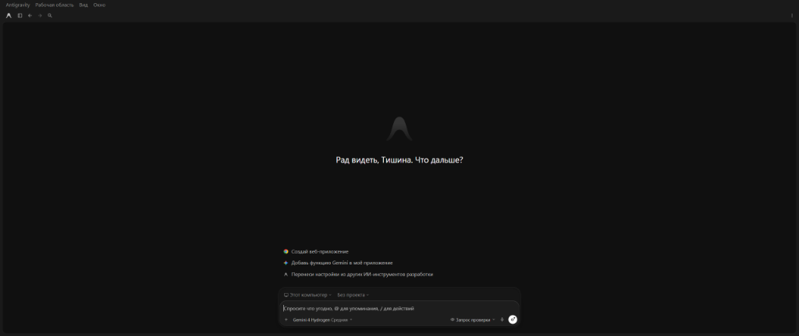
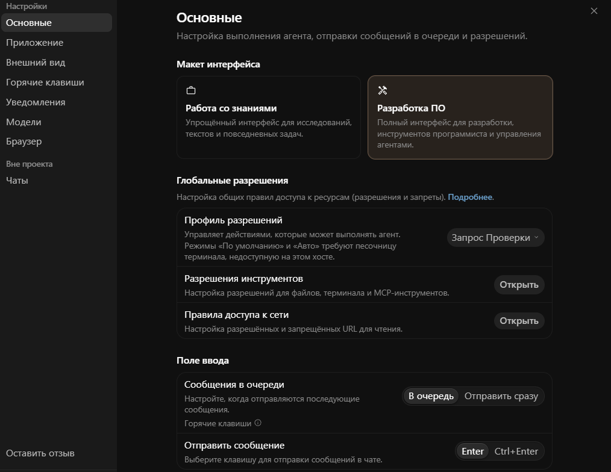
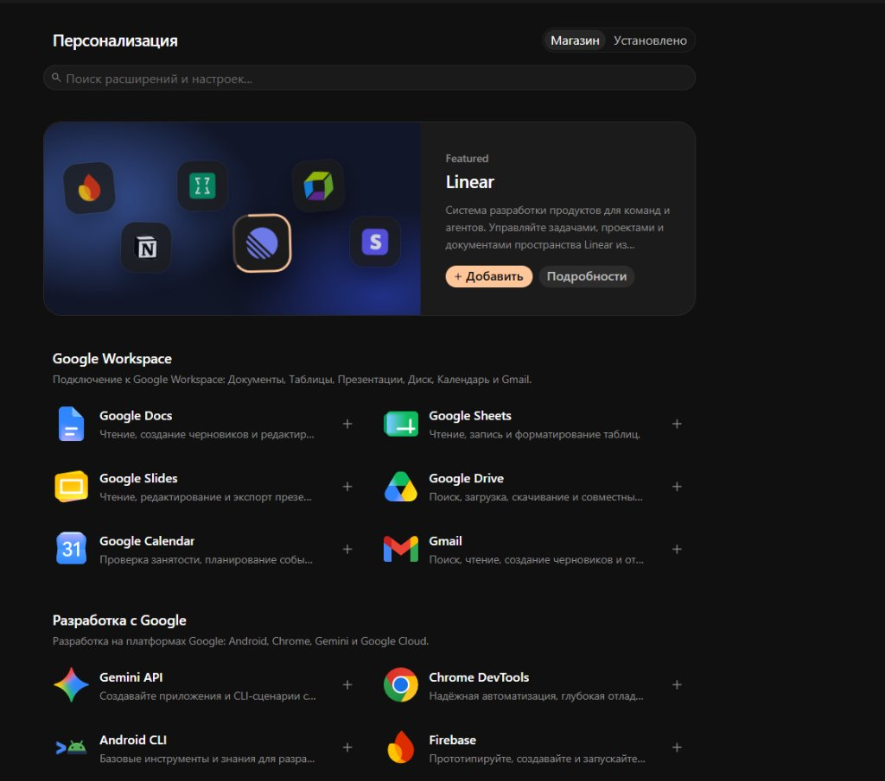
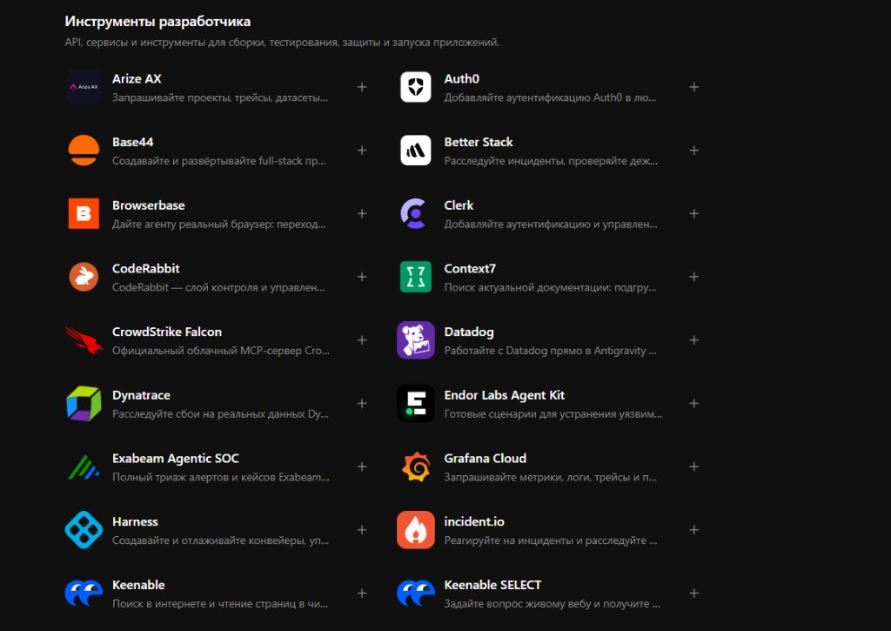
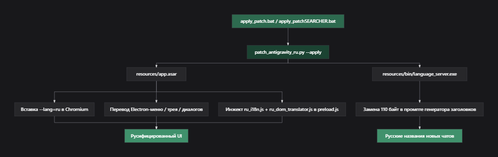

# Патч русификации Google Antigravity (v2.0.0)

[](https://github.com/sensitivecode/antigravity-ru-patch/releases/latest)
[](https://github.com/sensitivecode/antigravity-ru-patch/actions/workflows/ci.yml)
[](LICENSE)


Локализация десктопного приложения **Google Antigravity** (оболочка Electron + веб-интерфейс Hub + русские заголовки новых чатов) для Windows.

> [!TIP]
> **Быстрая установка:** скачайте готовый архив [`antigravity-ru-patch.zip`](https://github.com/sensitivecode/antigravity-ru-patch/releases/latest) со страницы **Releases** (качать весь исходный код репозитория через *Code → Download ZIP* не нужно).

---

## Скриншоты (v2.0.0)

| Главный экран и подсказки | Настройки и разрешения |
| :---: | :---: |
|  |  |
| **Маркетплейс плагинов и Google Workspace** | **Инструменты разработчика (109+ плагинов)** |
|  |  |

---

## Как это работает



---

## Русская версия (RU)

### Что переводится
1. **Системные ресурсы Chromium/Electron**: включается `--lang=ru` для встроенных диалогов, дат (`Intl`) и ресурсов `locales/ru.pak`.
2. **Оболочка Electron (`resources/app.asar`)**: меню, трей, автообновление, диалоги выбора папок/устройств/Passkey, мастер установки IDE, SSH/WSL, контекстные меню (`window:show-context-menu`).
3. **Веб-интерфейс (Hub UI)**: DOM-переводчик `ru_dom_translator.js` + словарь `ru_i18n.js` (боковая панель, стартовые подсказки и персоны, чаты, проекты, настройки, автоматизации, встроенный браузер, терминалы, статусы инструментов, а также 8 категорий и 109 плагинов маркетплейса) с защитой иконок, кода, терминала `xterm`, формул `KaTeX` и склейкой составных `Text`-узлов React.
4. **Названия новых чатов (`resources/bin/language_server.exe`)**: точечная замена промпта генератора заголовков (ровно 110 байт) для генерации названий чатов на русском языке. Отключается флагом `--no-ru-titles`.

### Что именно изменяется
- **Изменяются только 2 файла** (оба перед правкой сохраняются в `.bak`):
  1. `resources/app.asar` (резервная копия `resources/app.asar.bak`)
  2. `resources/bin/language_server.exe` (резервная копия `resources/bin/language_server.exe.bak`; не изменяется при передаче `--no-ru-titles`)
- **Не затрагиваются**: `Antigravity.exe`, `locales/*.pak`, все остальные `.dll`, `.exe` и ресурсы приложения.
- **Подпись и антивирус**: изменение `language_server.exe` делает его цифровую подпись недействительной (если она присутствует в конкретной сборке), из-за чего Windows SmartScreen или антивирус могут выдавать предупреждение. Если хотите изменять только `app.asar`, запускайте установку с флагом `--no-ru-titles`.

### Какой батник запускать
- [`apply_patch.bat`](apply_patch.bat) — **стандартный путь установки** (`%LOCALAPPDATA%\Programs\antigravity`).
- [`apply_patchSEARCHER.bat`](apply_patchSEARCHER.bat) — **нестандартная папка установки** (другой диск, перенесённая папка и т.д.): ищет по процессам, реестру, ярлыкам, `PATH` и фиксированным дискам с подтверждением `[Y/n]` (или выбором номера `[1-N]`, если найдено несколько установок).
- [`patch_debug.bat`](patch_debug.bat) — **диагностика и сброс**: откат к оригиналу, повторная установка патча и живой терминал логов.
- [`redo_patch.bat`](redo_patch.bat) — **быстрый откат на английский в 1 вопрос**: одним подтверждением `[Y/n]` закрывает Antigravity, возвращает оригинальные `.bak`-файлы, перезапускает Antigravity и закрывает консоль.
- [`restore_patch.bat`](restore_patch.bat) — **(for view log)** откат к оригинальным `.bak`-файлам с паузой в консоли для просмотра результата.

### Установка и требования
- **Требования**: Windows 10 / 11, Python 3.8+ (с python.org, добавленный в `PATH`).
1. Закройте **Antigravity** (или оставьте открытым — `apply_patch.bat` одним вопросом `[Y/n]` предложит автоматически закрыть приложение, установить патч, перезапустить Antigravity и закрыть консоль).
2. Запустите `apply_patch.bat` (для стандартного пути) или `apply_patchSEARCHER.bat` (для нестандартной папки), либо укажите путь вручную:
   ```bat
   apply_patch.bat --dir "C:\Путь\к\antigravity"
   python patch_antigravity_ru.py --apply --no-ru-titles
   ```

> [!NOTE]
> **Если перевод слетел** (после обновления Antigravity или восстановления файлов), повторно запустите `apply_patch.bat` (или `apply_patchSEARCHER.bat`). Патч обнаружит новую версию, обновит `.bak` и применит русификатор заново.

### Диагностика (`patch_debug.bat`)
- Создаёт папку `patchdebug` на Рабочем столе (`SHGetFolderPathW`, поддерживает перенос в OneDrive) и пишет лог `patch_debug_*.log`.
- Последовательно: плавно закрывает Antigravity → откатывает патч (при ошибке или отсутствии `.bak` сразу сообщает об этом и останавливается) → накатывает патч → запускает Antigravity.
- **Команды в терминале**: `stop` (остановить запись лога), `status` (статус процесса и патча), `open` (открыть `patchdebug`), `logs on` / `logs off` (включить/выключить чтение `main.log` и `language_server.log`).
- **Приватность логов**: по умолчанию пишутся **только** действия патчера. Трансляция `main.log` и `language_server.log` включается только командой `logs on` (или `--debug-logs`) — эти файлы могут содержать имя пользователя Windows в путях и фрагменты запросов. Всегда проверяйте лог перед публикацией.

### Откат и устранение неполадок
- Запустите `restore_patch.bat` или `python patch_antigravity_ru.py --restore`.
- При откате `language_server.exe` проверяется соответствие `.bak` текущему файлу (чужая версия не перезапишет новый exe; при отсутствии `.bak` выводится явная ошибка).

### Для разработчиков
В репозитории (но **не** в релизном zip-архиве) находятся служебные скрипты для разработки и проверки:
- `sync_and_verify.py` — собирает `antigravity-ru-patch.zip` на Рабочем столе, прогоняет `--dry-run`, тест `verify_patch.js` в Electron и проверяет целостность архива (`testzip()`).
- `test_bat_bugs.py` — набор регрессионных тестов для `.bat`-скриптов, поиска установок, безопасности `language_server.exe` и `patch_debug`.
- `verify_patch.js` — проверка целостности ASAR, синтаксиса всех 16 патченных JS-файлов в `vm.Script`, изоляции `preload.js` и DOM-переводчика.

### Частые вопросы (FAQ)
- **Обязательно ли устанавливать Python?** Да, патчер написан на открытом Python 3.8+ (`Add python.exe to PATH` при установке) без закрытых `.exe`-инсталляторов, чтобы весь код можно было проверить до запуска.
- **Почему внутренние рассуждения модели (`Думает X с`) внутри всё равно на английском?** Поток рассуждений генерируется «на лету» самой нейросетью на сервере, а не хранится в файлах интерфейса. Статический патч переводит сам статус, меню и кнопки, но не подменяет ответы ИИ.
- **Переводит ли патч встроенный редактор кода (IDE)?** Патч переводит десктопную оболочку, Hub UI, настройки, меню и окно запуска IDE; для русификации самого редактора VS Code / Monaco при желании можно дополнительно установить стандартный *Russian Language Pack*.
- **Windows SmartScreen или антивирус ругается на `.bat` / `language_server.exe`:** скачанные из интернета `.bat`-файлы имеют метку Windows (*Свойства → Разблокировать*), а правка `language_server.exe` сбрасывает его цифровую подпись. Чтобы не трогать `.exe`, запускайте установку с `--no-ru-titles`.

<details>
<summary><b>История версий (Changelog)</b></summary>

- **v2.0.0**: 2218+ фраз и regex-правил, перевод 8 категорий и 109 плагинов маркетплейса, фикс Tailwind-меню и составных `Text`-узлов React, `apply_patch.bat` в 1 подтверждение (с поддержкой русской раскладки `н`), новые скрипты `apply_patchSEARCHER.bat`, `redo_patch.bat`, `patch_debug.bat`.
- **v1.1.0**: русские заголовки новых чатов через 110-байтную правку `language_server.exe` (и флаг `--no-ru-titles`), перевод 28 строк onboarding-персон.
- **v1.0.0**: первый публичный релиз — перевод Electron shell + DOM-переводчик Hub Web UI под GPL-3.0.

</details>

### Отказ от ответственности
- Данный проект является **неофициальной** локализацией сообщества и **никак не связан с Google LLC**, не одобрен и не поддерживается компанией Google.
- Все упоминаемые товарные знаки и названия продуктов (*Google*, *Antigravity*, *Gemini*) принадлежат их законным правообладателям.
- В репозитории и релизах распространяются только собственные скрипты и словари локализации; оригинальные файлы и бинарники Google Antigravity не хранятся и не распространяются.
- Патч предоставляется по принципу **«как есть» (AS IS)**, без каких-либо гарантий работоспособности или совместимости с будущими версиями приложения. Пользователь выполняет локальную модификацию файлов на свой страх и риск.

---

## English Version (EN)

### Overview
Unofficial Russian localization patcher for **Google Antigravity** (Electron shell + Hub Web UI + Russian conversation title generation) on Windows.

### What Files Are Modified
- **Only 2 files are modified** (automatic `.bak` backups are created before patching):
  1. `resources/app.asar` (backup: `resources/app.asar.bak`) — enables Chromium `--lang=ru`, translates Electron menus/dialogs/tray/IPC menus, and injects `ru_i18n.js` + `ru_dom_translator.js` into `dist/preload.js`.
  2. `resources/bin/language_server.exe` (backup: `resources/bin/language_server.exe.bak`) — exact 110-byte replacement in the title-generator prompt so new chats receive Russian titles (can be skipped with `--no-ru-titles`).
- **Unchanged**: `Antigravity.exe`, `locales/*.pak`, and all other binaries/resources remain untouched.
- **Signature & Antivirus notice**: modifying `language_server.exe` invalidates any Authenticode digital signature it may carry in current or future builds, which can trigger Windows SmartScreen or antivirus heuristics. Pass `--no-ru-titles` to leave `language_server.exe` completely untouched.

### Which Script to Run
- [`apply_patch.bat`](apply_patch.bat) — default install path (`%LOCALAPPDATA%\Programs\antigravity`).
- [`apply_patchSEARCHER.bat`](apply_patchSEARCHER.bat) — custom/moved installation path; searches processes, registry, shortcuts, `PATH`, and fixed drives, then asks `[Y/n]` confirmation (or numbered choice `[1-N]`).
- [`patch_debug.bat`](patch_debug.bat) — diagnostic reset + live logger into `Desktop\patchdebug`.
- [`redo_patch.bat`](redo_patch.bat) — one-prompt English rollback, relaunches Antigravity and closes the terminal automatically.
- [`restore_patch.bat`](restore_patch.bat) — **(for view log)** restores original `.bak` files and pauses in the terminal so you can inspect the output.

### Requirements & Usage
- **Requirements**: Windows 10 / 11, Python 3.8+ (from python.org, added to `PATH`).
- Run `apply_patch.bat` (or `apply_patchSEARCHER.bat`), or manually:
  ```bat
  python patch_antigravity_ru.py --apply
  python patch_antigravity_ru.py --apply --dir "C:\Path\to\antigravity" --no-ru-titles
  python patch_antigravity_ru.py --restore
  ```
- If an Antigravity update resets localization to English, close Antigravity and re-run `apply_patch.bat` (or `apply_patchSEARCHER.bat`).

### Diagnostics (`patch_debug.bat`)
- Writes live patcher logs to `Desktop\patchdebug\patch_debug_*.log`.
- Console commands: `stop`, `status`, `open`, `logs on`, `logs off`.
- **Privacy notice**: by default only patcher events are logged. Antigravity's own `main.log` and `language_server.log` are only streamed when you explicitly run `logs on` (or `--debug-logs`), as they may include Windows usernames in paths and request snippets. Inspect and redact logs before sharing.

### For Developers
Maintained in the repository (excluded from release `.zip` archives):
- `sync_and_verify.py` — builds `Desktop\antigravity-ru-patch.zip`, runs `--dry-run`, executes `verify_patch.js`, and verifies zip integrity (`testzip()`).
- `test_bat_bugs.py` — automated regression tests for batch scripts, searcher, `language_server.exe` safety, and `cmd_debug`.
- `verify_patch.js` — Electron test harness validating ASAR integrity, `vm.Script` syntax across all 16 patched JS files, `preload.js` sandbox rules, and DOM translation.

### FAQ
- **Does it require Python?** Yes, the patcher uses plain Python 3.8+ (`Add python.exe to PATH`) instead of opaque `.exe` binaries so every line can be audited before running.
- **Why does internal model reasoning stay in English?** Model thinking traces are generated dynamically on remote servers rather than stored in local UI bundles; the patch localizes the Antigravity UI and titles, not live LLM prose.
- **Does it translate the code editor (IDE) workbench?** It localizes the Antigravity Electron shell, Hub UI, menus, and chat titles; for VS Code / Monaco editor panels you can optionally install the standard *Russian Language Pack*.

### Disclaimer
- This is an **unofficial community localization** and is **not affiliated with, endorsed by, or supported by Google LLC**.
- All trademarks (*Google*, *Antigravity*, *Gemini*) belong to their respective owners.
- Only localization scripts and dictionaries are distributed here; original Google Antigravity binaries and source files are not distributed.
- Provided **AS IS**, without warranty of any kind. Users modify local files at their own risk; use `restore_patch.bat` to revert changes.
